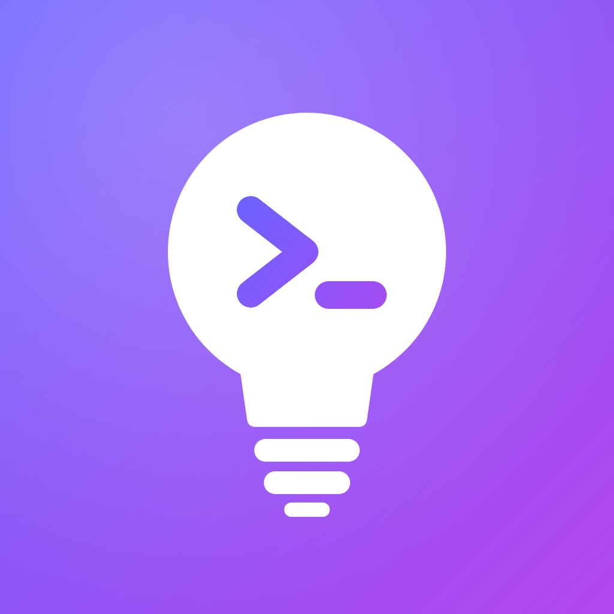
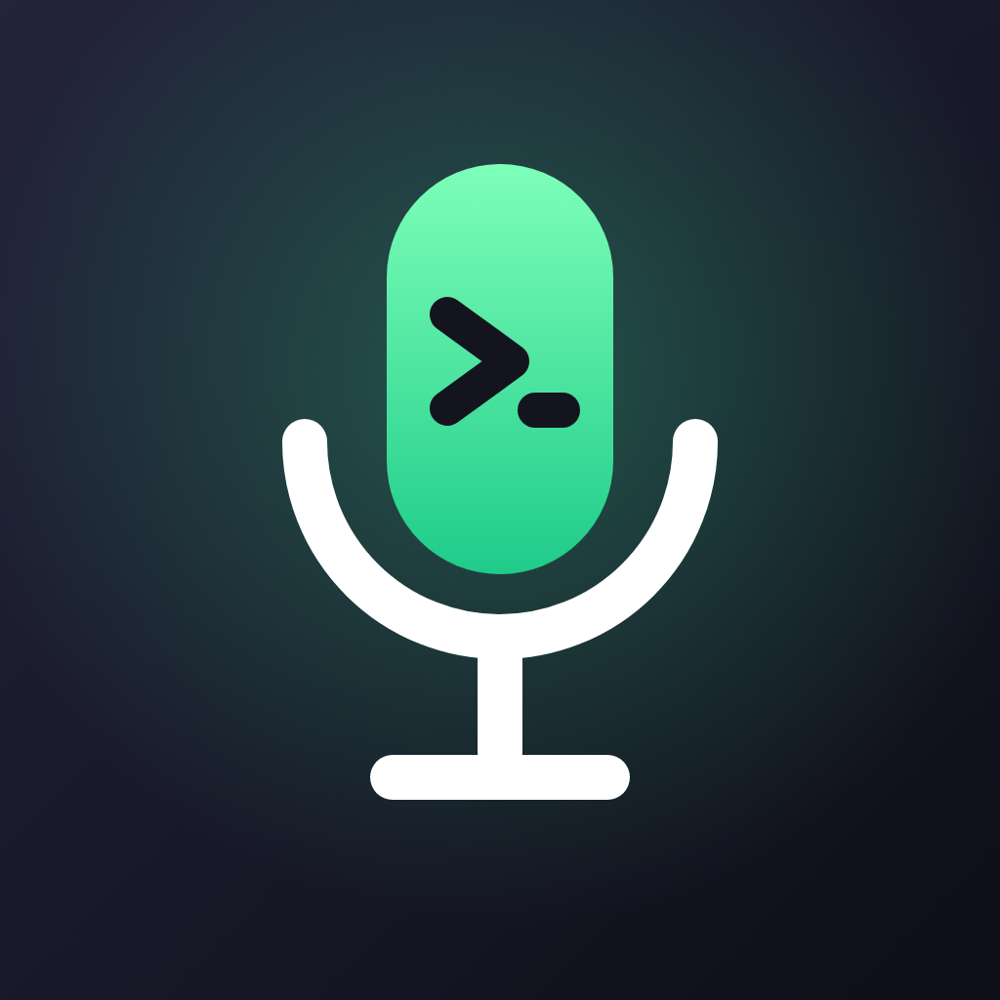
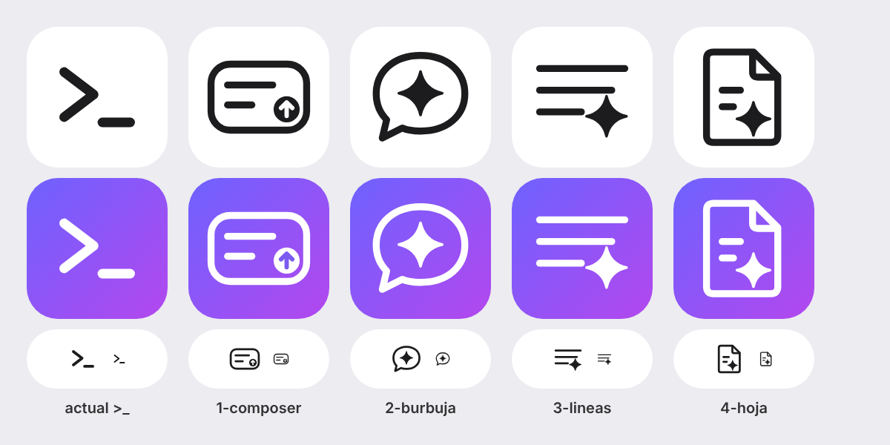

# Ideas to Prompts by Leonera Labs

App de iOS (SwiftUI, sin dependencias externas) para guardar ideas por voz cuando no tienes tiempo de desarrollarlas y, más tarde, tener un prompt listo para copiar en un agente.

## Cómo funciona

1. Abres la app y ves tus **Ideas**, con una barra inferior flotante (opaca, al estilo de iOS 26) con *Ideas*, *Buscar*, *Ajustes* y el botón **+**.
2. Con **+** eliges el tipo de idea (*iOS App*, *Web App*, *Desktop App*, *Edición*, *Resolver bug*, los tipos que añadas u *Otro*) y la grabas. No hace falta que esté pulida ni bien narrada.
3. Al terminar de grabar:
   - **Con internet**, la app transcribe la grabación y genera el prompt, un título y una descripción breve.
   - **Sin internet**, la idea se marca con el símbolo ☁︎ tachado (`icloud.slash`) y se procesa sola cuando vuelve la conexión.
4. En la lista, una idea procesada muestra su título y descripción; una sin procesar se muestra como **Idea #N**.
5. En el detalle puedes escuchar la grabación y **copiar el prompt o la transcripción**, regenerar el prompt o volver a transcribir.

### Del audio al prompt

- Cada tipo de idea tiene un **base prompt**. La IA solo rellena las partes entre `[[[ ]]]`; el resto se copia tal cual. El base prompt de *iOS App* incluye la configuración de despliegue de este mismo repositorio.
- Con el tipo **Otro**, el prompt se genera desde cero.
- El **prompt de transcripción a prompt** es editable en *Ajustes*. Por defecto pide estructurar la narración sin proponer nada ni definir edge cases que la grabación no menciona.
- Los tipos de idea (nombre, icono y base prompt) se añaden, editan, reordenan y borran en *Ajustes › Tipos de idea*.

### Ideas de tipo *Edición* y *Resolver bug* (Claude)

Para cambios en un repositorio que ya existe. *Resolver bug* funciona igual que *Edición*, pero su base prompt tiene tres secciones: **Contexto**, **Problema** y **Resultado esperado**.

1. En *Ajustes › GitHub* añades un **token clásico** de GitHub (con el permiso `repo` para incluir los privados; se guarda en el llavero). *Probar token* muestra la cuenta y cuántos repositorios ve.
2. Al procesar una idea de tipo *Edición* o *Resolver bug*, la app obtiene todos tus repositorios (`GET /user/repos`) y envía su nombre y descripción a la IA junto con la transcripción; la IA rellena el base prompt y elige el repositorio.
3. En el detalle de la idea se muestra el repositorio que eligió la IA (y su rama principal), puedes elegir el modo **Code** o **Plan** y si se envía el **Prompt** o la **Transcripción**, y el botón **Abrir en Claude** abre la app de Claude con todo preseleccionado:

   ```
   claude://code/new?repo=<owner/repo>&branch=<rama>&mode=<code|plan>&q=<prompt o transcripción codificado>
   ```

   Sin token (o si la IA no identifica el repositorio) se omiten `repo` y `branch`, y el repositorio se elige en Claude.

### Proveedores de inferencia

Se configuran en *Ajustes* (la API key se guarda en el llavero). Todos se usan con su API compatible con OpenAI; la URL base y los modelos son editables.

| Proveedor | URL base | Chat | Transcripción |
|---|---|---|---|
| OpenAI | `https://api.openai.com/v1` | `gpt-4.1-mini` | `gpt-4o-mini-transcribe` (`/audio/transcriptions`) |
| Groq | `https://api.groq.com/openai/v1` | `openai/gpt-oss-120b` | `whisper-large-v3-turbo` (`/audio/transcriptions`) |
| Gemini | `https://generativelanguage.googleapis.com/v1beta/openai` | `gemini-2.5-flash` | `gemini-2.5-flash` (audio como `input_audio` en `/chat/completions`) |
| Cloudflare | `https://api.cloudflare.com/client/v4/accounts/{account_id}/ai/v1` | `@cf/meta/llama-3.3-70b-instruct-fp8-fast` | `@cf/openai/whisper-large-v3-turbo` (`…/ai/run/{modelo}`) |

Gemini y Workers AI no exponen `/audio/transcriptions`, por eso la transcripción usa la alternativa indicada. Las grabaciones se guardan en WAV de 16 kHz mono, un formato que aceptan los cuatro.

## Logos

Cuatro propuestas con el estilo de los iconos de iOS (fuentes SVG y PNG de 1024 px en [`Branding/logos`](Branding/logos)). Las cuatro van en la app: se elige en *Ajustes › Icono de la app*. *Bombilla* es el icono principal.

| Bombilla | Onda | Burbuja | Micrófono |
|---|---|---|---|
|  |  |  |  |
| Una idea que se vuelve prompt (`>_`). | La voz (onda) convertida en texto. | Una nota de voz con chispa de IA. | Micrófono con prompt de terminal. |

### Símbolos de prompt

Cuatro propuestas para sustituir `>_`, que se lee como una terminal, por un símbolo de prompt para un LLM. Son SVG monocromos (trazo de 16 sobre 256, color `currentColor`) en [`Branding/simbolos`](Branding/simbolos).



| Composer | Burbuja | Líneas | Hoja |
|---|---|---|---|
| Caja de texto de un chat con IA y botón de enviar. | Mensaje para la IA: burbuja con chispa. | Texto que la IA completa: líneas que terminan en chispa. | Instrucción escrita: hoja con chispa. |

## Desarrollo

El proyecto de Xcode se genera con [XcodeGen](https://github.com/yonaskolb/XcodeGen) a partir de `project.yml`:

```sh
brew install xcodegen
xcodegen generate
open IdeasToPrompts.xcodeproj
```

- iOS 17 o posterior, solo iPhone.
- Bundle ID: `com.leonardoramirezr.Ideastopromptsbyleoneralabs` (build setting `APP_BUNDLE_ID`; el workflow lo pasa a `xcodebuild`).
- Código en `IdeasToPrompts/`: `Models/`, `Services/` (grabación, proveedores, persistencia) y `Views/`.

## Despliegue: instalar desde Safari

Cada push compila la app, la firma Ad Hoc y publica el IPA en GitHub Pages para instalarla desde Safari en el iPhone. Lo hace [`.github/workflows/build.yml`](.github/workflows/build.yml) en `macos-15`, en cada push a cualquier rama salvo `gh-pages`, y también se puede lanzar a mano.

### Secrets necesarios

En *Settings › Secrets and variables › Actions* del repositorio (deben ser secrets del repositorio, no de una organización, si el repo es personal):

| Secret | Contenido |
|---|---|
| `ASC_KEY_ID` | Key ID de la clave de API de App Store Connect. |
| `ASC_ISSUER_ID` | Issuer ID de App Store Connect. |
| `ASC_KEY_P8` | Contenido completo del archivo `.p8`. Debe ser una *Team Key* con rol **Admin**. |
| `APPLE_TEAM_ID` | Team ID de Apple Developer. |

Sin ninguno de los cuatro, el workflow genera un IPA **sin firmar** y lo adjunta como artefacto (no publica nada). Si solo hay algunos, falla con un error que indica cuáles faltan.

### Activar GitHub Pages

Después del **primer build firmado** (que crea la rama `gh-pages`), activa *Settings › Pages* con *Deploy from a branch*, la rama **`gh-pages`** y la carpeta **`/ (root)`**.

La portada lista todos los builds y tiene un botón para instalar la última versión estable. Cada build tiene su carpeta con el IPA, `manifest.plist`, `index.html` (botón `itms-services://`) y `build.json`.

### Añadir un iPhone

Basta con registrar su UDID en el portal de Apple Developer (*Certificates, Identifiers & Profiles › Devices*) y hacer push: el siguiente build genera un perfil Ad Hoc que incluye todos los dispositivos registrados.

### Qué hace el workflow

- **Etiquetas y releases.** En `main`, la etiqueta es `0.x.0` (sube el número intermedio respecto al último tag) y se publica como release estable *Latest*. En otras ramas es `build-<run_number>-<sha7>` y se publica como pre-release. El enlace de instalación aparece en el resumen de la ejecución y en las notas de la release.
- **Sin cancelaciones.** `concurrency.group` es `main` en main y el `run_id` en el resto, con `cancel-in-progress: false`.
- **Validación previa.** [`scripts/asc.py`](scripts/asc.py) (solo stdlib + `openssl` para el JWT ES256) comprueba que la clave funciona y que hay al menos un dispositivo iOS registrado.
- **Firma.** `xcodebuild archive` con firma automática y `-allowProvisioningUpdates` y la clave de API: Xcode registra el App ID y crea los perfiles. La exportación usa `method=release-testing` con el certificado de distribución gestionado en la nube, y luego se verifica que cada bundle lleva un `embedded.mobileprovision` Ad Hoc y cuántos dispositivos incluye.
- **Limpieza.** Se revocan por la API los certificados *Apple Development* temporales que crea `xcodebuild` en cada ejecución (solo los nuevos), aunque el build falle.
- **Publicación.** [`scripts/publish-pages.sh`](scripts/publish-pages.sh) reescribe `gh-pages` como un único commit huérfano (los IPA no se acumulan en el historial), conserva solo las carpetas con `build.json`, guarda todas las versiones de `main` y los últimos 20 builds de ramas, añade `.nojekyll` y reintenta si otro build publica a la vez.
